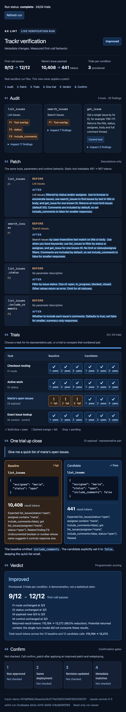

# Hosted main deployment and three-run stability check

Provisional: 3 trials per condition. A demonstration, not a statistical claim.

## Checkpoint steps 1–5

1. **Merged and pushed main.** E/F/G are integrated, with five product tools plus ping and preview_run. Typecheck, all 66 Vitest tests and production build passed during integration. The added hosted acceptance script also passes typecheck; no runtime implementation or dependency change was needed for this deployment.

2. **Trackr baseline restored and still live.** Revert commit f9b6c2beae2ec8c5774a7b902349618052582f2f preserves history. Before every run and after all three, serverInfo.version is trackr-demo-001@f9b6c2beae2ec8c5774a7b902349618052582f2f and the full tools hash is sha256:df53e86195ee4202079dc899964072aa655d72e1b3b0c81fdd3db03c6e7737d5. All three descriptions match the frozen baseline byte-for-byte. Local Trackr source remains unchanged at that commit.

3. **Manufact switched to main and deployed.** The user authorized the assistant to make the switch. Production deployment 0cd5ee08-1a12-4aae-bcc4-409f1c062600 is running main at ed539951258a6b78ecd597881d02e9ef20c7a669. The existing MCP URL is https://fast-pulse-rlqvb.run.mcp-use.com/mcp. Production initially lacked AXLINT_MODEL; it was set to claude-sonnet-5-5 and the release was redeployed before any stability model calls. Existing secrets and bearer auth are preserved. A pre-cutover probe while the first build was in progress still reached v0.2.1 with only ping/preview_run; the post-cutover checks below passed on v0.3.0.

4. **Three consecutive real hosted propose/verify workflows completed.** Each independently audits the baseline, selects the raw audit’s F1/F2/F3 (overlap, status values, payload control), requests a fresh compact proposal using the same pinned source files, calls verify_patch, and polls get_verification_result to completion. The exact four tasks from the prior S6 input, three trials per task/condition, model-default sampling and no temperature are unchanged. Results come from fresh Blaxel runs through the public authenticated MCP endpoint. All 72 trials are retained; no failed trial or unfavorable proposal was replaced.

5. **Stopped with Trackr baseline intact.** None of these calls applies source edits, so a second revert is unnecessary. No confirm_patch call was made and the real viewer truthfully shows confirmation as Not checked. The user owns the S8 seven-check milestone in Claude Code.

## Three-run outcomes

| Run | Patch ops | Verdict | Passes baseline → candidate | Result tokens baseline → candidate | Static tokens baseline → candidate | Hosted launch |
| --- | ---: | --- | --- | ---: | ---: | ---: |
| 1 | 4 | Improved | 9/12 → 12/12 | 115,194 → 13,272 | 651 → 907 | 997.1 ms |
| 2 | 4 | Improved | 9/12 → 12/12 | 115,194 → 13,272 | 651 → 911 | 894.4 ms |
| 3 | 5 | Improved | 9/12 → 12/12 | 115,194 → 13,702 | 651 → 947 | 958.0 ms |

**Inconclusive: 0/3.** All three runs keep routing, status and control at 3/3 in both conditions; payload improves 0/3 → 3/3. All nine baseline payload failures remain in the evidence. No infrastructure failure, insufficient-data task or approximate result count occurred. All three observed hosted launches returned in under one second.

Run 3 has one within-condition call/token disagreement: t1-route candidate trials 1 and 2 query checkout (559 result tokens), while trial 3 queries checkout page (344). All three pass the unchanged scorer. Runs 1 and 2 have no within-condition disagreements; no run has pass/fail disagreement. Proposal wording and operation count vary, so static costs differ from each other and from the frozen S3 compact patch (837 candidate tokens); these fresh proposals must not be relabelled as that frozen patch.

**Recommendation for discussion:** demo live with the recorded preview_run fallback ready. Three consecutive Improved outcomes support that choice for this demonstration; they are not a statistical reliability claim. The user chooses live versus recording.

## Actual acceptance output

```text
PASS hosted main: version0.3.0; all seven tools; authenticated ping; missing bearer401 without OAuth header
Tools: audit_server, confirm_patch, get_verification_result, ping, preview_run, propose_patch, verify_patch
Authenticated ping: pong: all platform checks passed
PASS hosted public widget assets: ping (2)
PASS hosted public widget assets: preview_run (2)
PASS hosted public widget assets: get_verification_result (2)
PASS public health:200; fields status, timestamp
PASS OAuth metadata routes:404
RUN 1 COMPLETE: improved; passes 9/12 → 12/12; result tokens 115194 → 13272; static 651 → 907; fresh real context widget PASS
RUN 2 COMPLETE: improved; passes 9/12 → 12/12; result tokens 115194 → 13272; static 651 → 911; fresh real context widget PASS
RUN 3 COMPLETE: improved; passes 9/12 → 12/12; result tokens 115194 → 13702; static 651 → 947; fresh real context widget PASS
PASS three sequential hosted propose/verify runs; Trackr remains baseline.
```

Every fresh completed result includes render metadata derived from its saved context.json, progress.json and result.json: fixture=false, auditAvailable=true, patchAvailable=true, all prompts present, 24/24 trials, and no invented confirmation. The native hosted MCP App screenshot was visually inspected: actual audit, four-operation proposal, trial matrix, t3 spotlight 10,408 → 441, verdict 9/12 → 12/12, static tokens 651 → 907, and Not checked confirmation all render. This verifies the Inspector/native View path; the user’s Claude app/Claude Code S8 milestone remains pending.



## Patch operations and every trial

### Run 1: axlint-run-5ce8aaba-bb3a-4410-9d49-03bd849f5f69

[Raw proposal](../scripts/results/hosted-stability-2026-10-17T21-52-45.266Z/run-1-proposal.json) · [Summary](../scripts/results/hosted-stability-2026-10-17T21-52-45.266Z/run-1-summary.json)

```json
[
  {
    "op": "set_tool_description",
    "tool": "list_issues",
    "value": "List issues, filtered by status and/or assignee. Use to browse or enumerate issues; use search_issues to find issues by text in title or body, and get_issue for one known ID. Returns at most limit issues (default 50). Comments are included by default, so set include_comments to false for smaller responses.",
    "finding_ids": [
      "F1"
    ]
  },
  {
    "op": "set_tool_description",
    "tool": "search_issues",
    "value": "Search issues by case-insensitive text match on title or body. Use when you have keywords; use list_issues to filter by status or assignee, and get_issue for one known ID. No limit or status/assignee filters. Comments are included by default, so set include_comments to false for smaller responses.",
    "finding_ids": [
      "F1"
    ]
  },
  {
    "op": "set_param_description",
    "tool": "list_issues",
    "value": "Filter by issue status. One of: open, in_progress, blocked, closed. Other values return an error. Omit for all statuses.",
    "finding_ids": [
      "F2"
    ],
    "param": "status"
  },
  {
    "op": "set_param_description",
    "tool": "list_issues",
    "value": "Whether to include each issue's comments. Defaults to true; set false for smaller, summary-only responses.",
    "finding_ids": [
      "F3"
    ],
    "param": "include_comments"
  }
]
```

| Task | Condition | Trial | Tool | Arguments | Outcome | Result tokens |
| --- | --- | ---: | --- | --- | --- | ---: |
| t1-route | baseline | 1 | search_issues | `{"query":"checkout page"}` | pass | 6,570 |
| t1-route | baseline | 2 | search_issues | `{"query":"checkout page"}` | pass | 6,570 |
| t1-route | baseline | 3 | search_issues | `{"query":"checkout page"}` | pass | 6,570 |
| t1-route | candidate | 1 | search_issues | `{"query":"checkout page","include_comments":false}` | pass | 344 |
| t1-route | candidate | 2 | search_issues | `{"query":"checkout page","include_comments":false}` | pass | 344 |
| t1-route | candidate | 3 | search_issues | `{"query":"checkout page","include_comments":false}` | pass | 344 |
| t2-status | baseline | 1 | list_issues | `{"status":"in_progress"}` | pass | 18,770 |
| t2-status | baseline | 2 | list_issues | `{"status":"in_progress"}` | pass | 18,770 |
| t2-status | baseline | 3 | list_issues | `{"status":"in_progress"}` | pass | 18,770 |
| t2-status | candidate | 1 | list_issues | `{"status":"in_progress","include_comments":false}` | pass | 989 |
| t2-status | candidate | 2 | list_issues | `{"status":"in_progress","include_comments":false}` | pass | 989 |
| t2-status | candidate | 3 | list_issues | `{"status":"in_progress","include_comments":false}` | pass | 989 |
| t3-payload | baseline | 1 | list_issues | `{"assignee":"maria","status":"open"}` | fail: bad_args | 10,408 |
| t3-payload | baseline | 2 | list_issues | `{"assignee":"maria","status":"open"}` | fail: bad_args | 10,408 |
| t3-payload | baseline | 3 | list_issues | `{"assignee":"maria","status":"open"}` | fail: bad_args | 10,408 |
| t3-payload | candidate | 1 | list_issues | `{"assignee":"maria","status":"open","include_comments":false}` | pass | 441 |
| t3-payload | candidate | 2 | list_issues | `{"assignee":"maria","status":"open","include_comments":false}` | pass | 441 |
| t3-payload | candidate | 3 | list_issues | `{"assignee":"maria","status":"open","include_comments":false}` | pass | 441 |
| t4-control | baseline | 1 | get_issue | `{"id":"TRK-117"}` | pass | 2,650 |
| t4-control | baseline | 2 | get_issue | `{"id":"TRK-117"}` | pass | 2,650 |
| t4-control | baseline | 3 | get_issue | `{"id":"TRK-117"}` | pass | 2,650 |
| t4-control | candidate | 1 | get_issue | `{"id":"TRK-117"}` | pass | 2,650 |
| t4-control | candidate | 2 | get_issue | `{"id":"TRK-117"}` | pass | 2,650 |
| t4-control | candidate | 3 | get_issue | `{"id":"TRK-117"}` | pass | 2,650 |

### Run 2: axlint-run-49279710-1dfa-4e6f-ad80-77992da8d99e

[Raw proposal](../scripts/results/hosted-stability-2026-10-17T21-52-45.266Z/run-2-proposal.json) · [Summary](../scripts/results/hosted-stability-2026-10-17T21-52-45.266Z/run-2-summary.json)

```json
[
  {
    "op": "set_tool_description",
    "tool": "list_issues",
    "value": "Browse issues filtered by status and/or assignee. Use for structured listing; use search_issues to find issues by text in title or body, and get_issue for one known ID. Returns at most 50 issues unless limit is set. Comments are included by default, so set include_comments=false for smaller responses.",
    "finding_ids": [
      "F1"
    ]
  },
  {
    "op": "set_tool_description",
    "tool": "search_issues",
    "value": "Find issues by case-insensitive text match against title and body. Use when you have keywords; use list_issues to filter by status or assignee, and get_issue for one known ID. Has no limit parameter and returns all matches, with comments included by default; set include_comments=false for smaller responses.",
    "finding_ids": [
      "F1"
    ]
  },
  {
    "op": "set_param_description",
    "tool": "list_issues",
    "value": "Filter by issue status. One of: open, in_progress, blocked, closed. Any other value returns an error. Omit to include all statuses.",
    "finding_ids": [
      "F2"
    ],
    "param": "status"
  },
  {
    "op": "set_param_description",
    "tool": "list_issues",
    "value": "Whether each returned issue includes its comments. Defaults to true when omitted; set false to reduce response size.",
    "finding_ids": [
      "F3"
    ],
    "param": "include_comments"
  }
]
```

| Task | Condition | Trial | Tool | Arguments | Outcome | Result tokens |
| --- | --- | ---: | --- | --- | --- | ---: |
| t1-route | baseline | 1 | search_issues | `{"query":"checkout page"}` | pass | 6,570 |
| t1-route | baseline | 2 | search_issues | `{"query":"checkout page"}` | pass | 6,570 |
| t1-route | baseline | 3 | search_issues | `{"query":"checkout page"}` | pass | 6,570 |
| t1-route | candidate | 1 | search_issues | `{"query":"checkout page","include_comments":false}` | pass | 344 |
| t1-route | candidate | 2 | search_issues | `{"query":"checkout page","include_comments":false}` | pass | 344 |
| t1-route | candidate | 3 | search_issues | `{"query":"checkout page","include_comments":false}` | pass | 344 |
| t2-status | baseline | 1 | list_issues | `{"status":"in_progress"}` | pass | 18,770 |
| t2-status | baseline | 2 | list_issues | `{"status":"in_progress"}` | pass | 18,770 |
| t2-status | baseline | 3 | list_issues | `{"status":"in_progress"}` | pass | 18,770 |
| t2-status | candidate | 1 | list_issues | `{"status":"in_progress","include_comments":false}` | pass | 989 |
| t2-status | candidate | 2 | list_issues | `{"status":"in_progress","include_comments":false}` | pass | 989 |
| t2-status | candidate | 3 | list_issues | `{"status":"in_progress","include_comments":false}` | pass | 989 |
| t3-payload | baseline | 1 | list_issues | `{"assignee":"maria","status":"open"}` | fail: bad_args | 10,408 |
| t3-payload | baseline | 2 | list_issues | `{"assignee":"maria","status":"open"}` | fail: bad_args | 10,408 |
| t3-payload | baseline | 3 | list_issues | `{"assignee":"maria","status":"open"}` | fail: bad_args | 10,408 |
| t3-payload | candidate | 1 | list_issues | `{"assignee":"maria","status":"open","include_comments":false}` | pass | 441 |
| t3-payload | candidate | 2 | list_issues | `{"assignee":"maria","status":"open","include_comments":false}` | pass | 441 |
| t3-payload | candidate | 3 | list_issues | `{"assignee":"maria","status":"open","include_comments":false}` | pass | 441 |
| t4-control | baseline | 1 | get_issue | `{"id":"TRK-117"}` | pass | 2,650 |
| t4-control | baseline | 2 | get_issue | `{"id":"TRK-117"}` | pass | 2,650 |
| t4-control | baseline | 3 | get_issue | `{"id":"TRK-117"}` | pass | 2,650 |
| t4-control | candidate | 1 | get_issue | `{"id":"TRK-117"}` | pass | 2,650 |
| t4-control | candidate | 2 | get_issue | `{"id":"TRK-117"}` | pass | 2,650 |
| t4-control | candidate | 3 | get_issue | `{"id":"TRK-117"}` | pass | 2,650 |

### Run 3: axlint-run-d0119595-a705-4229-89ee-29b93d71d6db

[Raw proposal](../scripts/results/hosted-stability-2026-10-17T21-52-45.266Z/run-3-proposal.json) · [Summary](../scripts/results/hosted-stability-2026-10-17T21-52-45.266Z/run-3-summary.json)

```json
[
  {
    "op": "set_tool_description",
    "tool": "list_issues",
    "value": "List issues filtered by status and/or assignee, up to a limit. Use to browse or filter by those fields; use search_issues to find issues by text in title or body, and get_issue for one known ID. Returns at most 50 issues by default. Comments are included by default, so set include_comments=false for compact results.",
    "finding_ids": [
      "F1"
    ]
  },
  {
    "op": "set_tool_description",
    "tool": "search_issues",
    "value": "Search issues by case-insensitive text match on title or body. Use when you have keywords; use list_issues to filter by status or assignee, and get_issue for one known ID. No limit parameter, so all matches are returned. Comments are included by default; set include_comments=false for compact results.",
    "finding_ids": [
      "F1"
    ]
  },
  {
    "op": "set_param_description",
    "tool": "list_issues",
    "value": "Filter by issue status. One of: open, in_progress, blocked, closed. Other values return an error. Omit for all statuses.",
    "finding_ids": [
      "F2"
    ],
    "param": "status"
  },
  {
    "op": "set_param_description",
    "tool": "list_issues",
    "value": "Whether to include each issue's comments. Defaults to true; set false for smaller, summary-only responses.",
    "finding_ids": [
      "F3"
    ],
    "param": "include_comments"
  },
  {
    "op": "set_param_description",
    "tool": "search_issues",
    "value": "Whether to include each issue's comments. Defaults to true; set false for smaller, summary-only responses.",
    "finding_ids": [
      "F3"
    ],
    "param": "include_comments"
  }
]
```

| Task | Condition | Trial | Tool | Arguments | Outcome | Result tokens |
| --- | --- | ---: | --- | --- | --- | ---: |
| t1-route | baseline | 1 | search_issues | `{"query":"checkout page"}` | pass | 6,570 |
| t1-route | baseline | 2 | search_issues | `{"query":"checkout page"}` | pass | 6,570 |
| t1-route | baseline | 3 | search_issues | `{"query":"checkout page"}` | pass | 6,570 |
| t1-route | candidate | 1 | search_issues | `{"query":"checkout","include_comments":false}` | pass | 559 |
| t1-route | candidate | 2 | search_issues | `{"query":"checkout","include_comments":false}` | pass | 559 |
| t1-route | candidate | 3 | search_issues | `{"query":"checkout page","include_comments":false}` | pass | 344 |
| t2-status | baseline | 1 | list_issues | `{"status":"in_progress"}` | pass | 18,770 |
| t2-status | baseline | 2 | list_issues | `{"status":"in_progress"}` | pass | 18,770 |
| t2-status | baseline | 3 | list_issues | `{"status":"in_progress"}` | pass | 18,770 |
| t2-status | candidate | 1 | list_issues | `{"status":"in_progress","include_comments":false}` | pass | 989 |
| t2-status | candidate | 2 | list_issues | `{"status":"in_progress","include_comments":false}` | pass | 989 |
| t2-status | candidate | 3 | list_issues | `{"status":"in_progress","include_comments":false}` | pass | 989 |
| t3-payload | baseline | 1 | list_issues | `{"assignee":"maria","status":"open"}` | fail: bad_args | 10,408 |
| t3-payload | baseline | 2 | list_issues | `{"assignee":"maria","status":"open"}` | fail: bad_args | 10,408 |
| t3-payload | baseline | 3 | list_issues | `{"assignee":"maria","status":"open"}` | fail: bad_args | 10,408 |
| t3-payload | candidate | 1 | list_issues | `{"assignee":"maria","status":"open","include_comments":false}` | pass | 441 |
| t3-payload | candidate | 2 | list_issues | `{"assignee":"maria","status":"open","include_comments":false}` | pass | 441 |
| t3-payload | candidate | 3 | list_issues | `{"assignee":"maria","status":"open","include_comments":false}` | pass | 441 |
| t4-control | baseline | 1 | get_issue | `{"id":"TRK-117"}` | pass | 2,650 |
| t4-control | baseline | 2 | get_issue | `{"id":"TRK-117"}` | pass | 2,650 |
| t4-control | baseline | 3 | get_issue | `{"id":"TRK-117"}` | pass | 2,650 |
| t4-control | candidate | 1 | get_issue | `{"id":"TRK-117"}` | pass | 2,650 |
| t4-control | candidate | 2 | get_issue | `{"id":"TRK-117"}` | pass | 2,650 |
| t4-control | candidate | 3 | get_issue | `{"id":"TRK-117"}` | pass | 2,650 |

## Lane H and remaining work

Lane H is complete and pushed at 539476234c123ad94eda208f2c4dc34460286a98 on lane/filesystem, separately from main. Its preregistered filesystem comparison is Improved: scored passes 4/9 → 9/9; result tokens 2,107,401 → 4,911 (−99.77%); static tokens 3,143 → 3,315. All 24 trials, the baseline fs-tests disagreement and source-fidelity/isolation/allowlist checks are in [its pushed report](https://github.com/horne-ra/yc-hackathon-make-something-agents-want/blob/lane/filesystem/docs/filesystem-results.md). No new dependency; not merged. No Yahoo Finance benchmark started.

No required deployment or three-run stability check is skipped. S8 and any source apply/redeploy/confirm are intentionally left for the user; two-hour elapsed persistence of these three fresh runs was not waited out (the original S4 proof was independently read at 130.38 minutes and the runner policy is 4h TTL with a 30m job limit). No package, lockfile or src/core change.

All request/response envelopes, intermediate polls, proposals, baseline snapshots, deployment/auth/asset checks, summaries and complete results are retained in [hosted-stability-2026-10-17T21-52-45.266Z](../scripts/results/hosted-stability-2026-10-17T21-52-45.266Z/complete.json); [full output](../scripts/results/hosted-stability-2026-10-17T21-52-45.266Z/harness.log).
